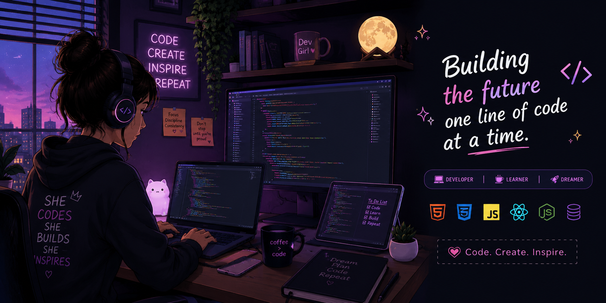

<!-- GitHub Profile README | Lihini Gimhani -->

  

<h1 align="center">Hi there, I'm Lihini Gimhani 👋</h1>
<h3 align="center">Software Engineering Undergraduate | Full-Stack Developer</h3>

  Building thoughtful web and mobile experiences, one project at a time.

  
  
  

👩‍💻 About Me
I'm a BSc (Hons) in Information Technology — Software Engineering undergraduate at SLIIT, with hands-on experience delivering and maintaining full-stack web applications during my internship at Ceylon X Corporation.
- 💼 Former Full Stack Developer Intern at Ceylon X Corporation (Jan–Jul 2026)
- 🧩 Worked on enterprise HRM and CRM applications, reusable React components, REST API integration, testing and debugging
- 📱 Interested in mobile development with React Native, Flutter and Kotlin
- ☁️ Exploring AWS cloud, serverless architecture and DevOps
- 🤖 Learning more about AI/ML and intelligent systems
- 🎯 Interested in Junior / Associate Software Engineer opportunities
- 🎨 I enjoy clean UI/UX, practical solutions and continuous learning
🛠️ Technical Toolbox
Languages

Frontend & Mobile

Backend & Databases

Cloud, DevOps & Tools

💼 Professional Experience
Full Stack Developer Intern — Ceylon X Corporation
January 2026 – July 2026
- Contributed to responsive HRM and CRM applications using React.js, Vite and JavaScript.
- Built and maintained reusable UI components, integrated REST APIs with Node.js and Express.js backends.
- Investigated UI, validation and data-mapping issues using browser developer tools and Postman.
- Collaborated with developers, QA and supervisors using Agile workflows and Git/GitHub.
🔒 Enterprise internship projects are described here without exposing private company source code.

🚀 Featured Projects
Project	What it does	Tech
Arogya	Distributed healthcare channeling platform exploring microservices and containerized deployment.	MERN, Docker, Kubernetes, PostgreSQL
ROOHUB	Full-stack roommate discovery and management platform.	React, Node.js, Express, MongoDB
ResQ1 — Disaster Early Warning	Mobile app concept for disaster alerts and emergency response support.	React Native
Wildlife Conservation & Anti-Poaching	Mobile system concept for incident reporting, patrols and conservation monitoring.	React Native
MediReach	Healthcare management platform with CRUD workflows and database integration.	React, Node.js, Express, MySQL
Personal Library Manager	Desktop app for organizing and managing a book collection.	Java Swing, MySQL

  

🎓 Education & Learning
Sri Lanka Institute of Information Technology (SLIIT)
BSc (Hons) in Information Technology — Software Engineering | 2023–Present

Selected learning & certifications
- ☁️ AWS Cloud Practitioner Essentials
- ⚡ AWS Lambda Foundations & Amazon API Gateway for Serverless Applications
- 🏗️ Designing Event-Driven Architectures & AWS CDK Getting Started
- 🔔 Amazon EventBridge, Amazon SNS & AWS AppSync
- 🤖 Amazon Q Developer Getting Started
- 🐍 Python for Beginners — University of Moratuwa
- 🌐 Web Design for Beginners — University of Moratuwa
🌱 Currently Exploring
📱 Cross-platform mobile development
☁️ AWS serverless and cloud-native application design
🤖 AI / ML fundamentals and intelligent applications
🧪 Better testing, architecture and developer workflows
🤝 Let's Connect
I'm keen to connect with fellow developers, collaborate on meaningful projects, and explore opportunities in software engineering.

  
  

<i>✨ Code. Learn. Build. Repeat.</i>

